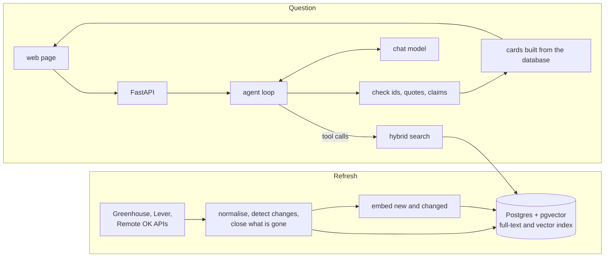

# InternScout

A job-search assistant over real job postings that shows where every answer came from.
**Work in progress: it runs locally and is not deployed yet.**

You say what you are looking for. A language model searches an index of postings from public
job-board APIs, picks the ones that fit and says why, with a quote from each posting. Job titles,
companies and links always come from the database, never from the model. It is meant for students
and early-career job seekers.

## How it works

## Status
| Part | State |
|---|---|
| Ingestion with change detection and outage-safe expiry | Done: 2,940 postings from 15 boards |
| Keyword, semantic, hybrid and re-ranked search; likes and dislikes | Done |
| Retrieval benchmark | Done; AI-graded, human check agreed only moderately |
| Agent with tools, memory and checked answers; web page | Done; evaluated over two prompt versions |
| Grounding measurement | Code checks done; AI judge unreliable, human labels still to do |
| Rate limits, fallbacks, request logs, statistics, load test | Done |
| Docker image and compose file | Done |
| CI and daily refresh workflows | Written, never run (not on GitHub yet) |
| Deployment and real users | Not started |

## Results
Numbers come from files in `evals/results/` or [docs/limits.md](docs/limits.md). Details and
caveats: [docs/results.md](docs/results.md); failures:
[docs/failure_analysis.md](docs/failure_analysis.md).

### Retrieval (NDCG@10, 815 postings)
| Mode | Development (23 queries) | Test, run once (10 queries) |
|---|---|---|
| keyword | 0.633 | 0.571 |
| semantic | 0.861 | 0.803 |
| hybrid | 0.811 | 0.839 |
| hybrid + re-ranker | 0.789 | 0.719 |

- Hybrid clearly beats keyword search on both sets (test: +0.27, 95% interval 0.13 to 0.43).
- Semantic against hybrid is not settled: it led on development and not on test.
- The re-ranker did not help, and needs 828 MB of memory.
- One simulated like improved development NDCG@10 by 0.04 (interval 0.003 to 0.089).
- Relevance was **graded by an AI**. A blind human re-grade of 50 pairs agreed only moderately
  (weighted kappa 0.45).

### Agent (55 turns, two prompt versions)
| | Version 2 | Version 3 |
|---|---|---|
| Turns without a usable answer | 25% | 2% |
| NDCG@10 of its searches, 10 test queries | 0.598 | 0.808 |
| Median seconds per turn | 15.8 | 9.6 |
| Scripted conversations passed | 8 of 10 | 7 of 10 |

- Plain hybrid search with hand-written keywords scores 0.839 on the same queries.
- The jobs it picks are about as relevant as the same number of top search results.
- No made-up job ids. 7 of 85 quotes were not in the posting and were stopped before display.
- The AI judge of explanations proved unreliable, so there is no hallucination rate to quote.

### Service
- Median agent turn 9.6 s on the free model tier.
- With a stand-in model: 20 simultaneous users, 87 requests per second, no errors, p95 320 ms.
- The free chat quota is 500 requests a day, about 100 conversation turns.

## Design decisions
| Decision | Why |
|---|---|
| One Postgres for text, vectors, sessions and logs | One thing to run and keep consistent |
| Hybrid search with reciprocal rank fusion | Clearly better than keywords; also finds postings that have no embedding |
| The model returns ids; the database renders cards | A made-up company or link has no route to the screen |
| A plain agent loop, no framework | One short function that can be read and tested |
| Claims checked by code; an AI judge only in evaluation | Code checks are free and repeatable; the judge costs quota |
| Re-ranker left out of deployment | No measured gain, and too large for a 512 MB host |

## Run locally
The whole app with Docker (or Colima), then open http://127.0.0.1:8000:

    cp .env.example .env        # add a free Gemini API key
    docker compose up --build -d

The index starts empty. Fill it (Python 3.13):

    python3.13 -m venv .venv && source .venv/bin/activate
    pip install -r requirements.txt
    python -m app.ingest.run
    python -m app.embed         # slow on a free quota; safe to stop and resume
    pytest

Search from the terminal, or run the server without Docker:

    python -m app.retrieval.cli "python backend internship" --mode hybrid --level intern
    uvicorn app.api:app

## Evaluation commands
The benchmark runs on a frozen copy of the postings that is not in the repository, because it holds
their full text. The grades refer to that copy, so a fresh clone can read the code and the saved
results but cannot reproduce the exact numbers. `evals/corpus_2026-11-25.jsonl` lists its contents.

    pip install -r requirements-rerank.txt
    python -m evals.run_eval --mode hybrid --split dev    # retrieval
    python -m evals.agreement                             # human check of the grades
    python -m evals.personalization                       # likes experiment
    python -m evals.rerank_passage                        # re-ranker experiment
    python -m evals.agent_eval && python -m evals.judge   # needs a model key
    python -m evals.agent_report
    python -m evals.label_claims                          # label explanations yourself

## When things go wrong
Model busy or out of quota: plain search results with a notice. Embedding fails: keyword search.
Database down: 503. Limits: messages up to 1,000 characters, 20 per 10 minutes per session and per
address, and a daily token budget.

## Privacy and data sources
Messages are stored, to be deleted after 90 days, and are sent to Google's free Gemini API, which
may use them to improve its products: the page asks users not to type personal details. There are
no accounts. `python -m app.admin delete-session <id>` removes a conversation.

Postings come from the public job-board APIs of Greenhouse and Lever and from the Remote OK feed.
Results from Remote OK are credited "via Remote OK" with a link to the posting.

## Limitations
- The queries, their keywords and the relevance grades were all written by AI.
- 40 queries is small, and the test set smaller still.
- Postings that no search mode retrieved were never graded.
- Levels and countries come from simple rules, and there is no city filter.
- The postings come from 15 companies and boards; this is not a search of all jobs.
- The rate limiter is in memory and assumes one server process.

## Next
1. Label explanations by hand, fix or replace the judge, and fix the two conversation regressions.
2. Deploy, switch on the daily refresh, and collect real queries from at least 10 people.
3. A city filter, and a limit on near-identical postings in one page of results.

Walkthroughs of how each part works: [docs/walkthrough/](docs/walkthrough/).
